<!-- Generated by generator/render.mjs from https://kacpersaks.dev/profile.json. Edit generator/README.template.md or generator/templates/, not this file. -->

<a href="https://kacpersaks.dev"><picture><source media="(min-width: 1200px) and (prefers-color-scheme: dark)" srcset="./assets/header-wide-dark.png" width="744" /><source media="(min-width: 1200px) and (prefers-color-scheme: light)" srcset="./assets/header-wide-light.png" width="744" /><source media="(prefers-color-scheme: dark)" srcset="./assets/header-dark.png" />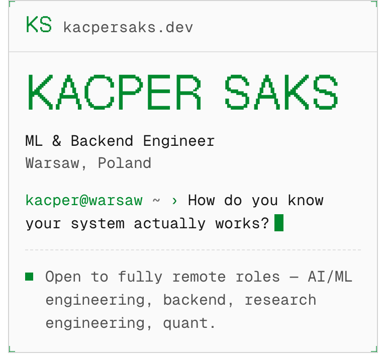</picture></a>

<a href="https://kacpersaks.dev"><picture><source media="(min-width: 1200px) and (prefers-color-scheme: dark)" srcset="./assets/statusbar-wide-dark.png" width="744" /><source media="(min-width: 1200px) and (prefers-color-scheme: light)" srcset="./assets/statusbar-wide-light.png" width="744" /><source media="(prefers-color-scheme: dark)" srcset="./assets/statusbar-dark.png" />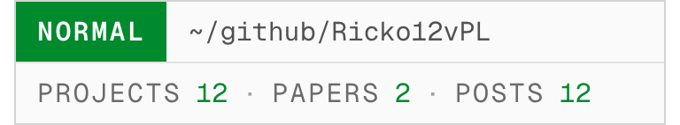</picture></a>

<a href="https://kacpersaks.dev"><picture><source media="(min-width: 1200px) and (prefers-color-scheme: dark)" srcset="./assets/rule-whoami-wide-dark.png" width="744" /><source media="(min-width: 1200px) and (prefers-color-scheme: light)" srcset="./assets/rule-whoami-wide-light.png" width="744" /><source media="(prefers-color-scheme: dark)" srcset="./assets/rule-whoami-dark.png" />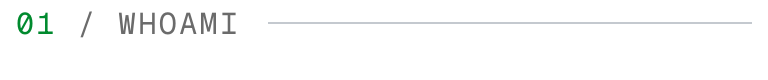</picture></a> <a href="https://kacpersaks.dev/projects"><picture><source media="(min-width: 1200px) and (prefers-color-scheme: dark)" srcset="./assets/terminal-wide-dark.png" width="744" /><source media="(min-width: 1200px) and (prefers-color-scheme: light)" srcset="./assets/terminal-wide-light.png" width="744" /><source media="(prefers-color-scheme: dark)" srcset="./assets/terminal-dark.png" />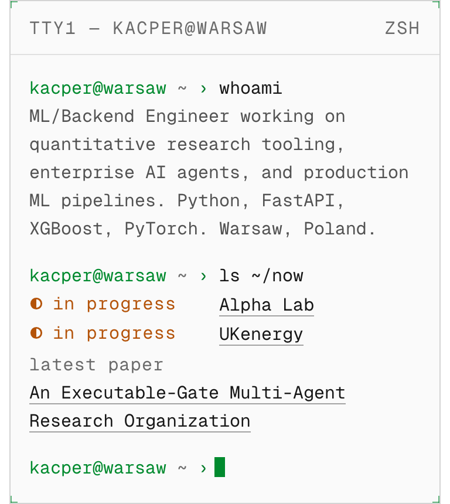</picture></a>

<a href="https://kacpersaks.dev"><picture><source media="(min-width: 1200px) and (prefers-color-scheme: dark)" srcset="./assets/rule-activity-wide-dark.png" width="744" /><source media="(min-width: 1200px) and (prefers-color-scheme: light)" srcset="./assets/rule-activity-wide-light.png" width="744" /><source media="(prefers-color-scheme: dark)" srcset="./assets/rule-activity-dark.png" /></picture></a> <a href="https://kacpersaks.dev"><picture><source media="(min-width: 1200px) and (prefers-color-scheme: dark)" srcset="./assets/fig1-wide-dark.png" width="744" /><source media="(min-width: 1200px) and (prefers-color-scheme: light)" srcset="./assets/fig1-wide-light.png" width="744" /><source media="(prefers-color-scheme: dark)" srcset="./assets/fig1-dark.png" />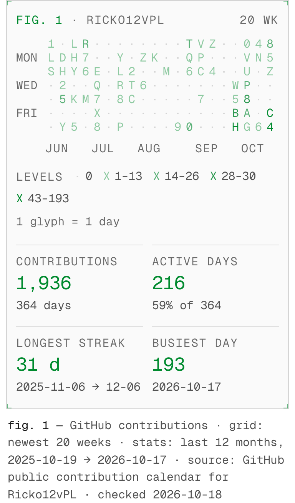</picture></a>

<a href="https://kacpersaks.dev/research"><picture><source media="(min-width: 1200px) and (prefers-color-scheme: dark)" srcset="./assets/section-research-connected-dark.png" width="744" /><source media="(min-width: 1200px) and (prefers-color-scheme: light)" srcset="./assets/section-research-connected-light.png" width="744" /><source media="(prefers-color-scheme: dark)" srcset="./assets/section-research-dark.png" /></picture></a> <a href="https://kacpersaks.dev/research/executable-gate-research-org"><picture><source media="(min-width: 1200px) and (prefers-color-scheme: dark)" srcset="./assets/paper-executable-gate-research-org-connected-dark.png" width="372" /><source media="(min-width: 1200px) and (prefers-color-scheme: light)" srcset="./assets/paper-executable-gate-research-org-connected-light.png" width="372" /><source media="(prefers-color-scheme: dark)" srcset="./assets/paper-executable-gate-research-org-dark.png" />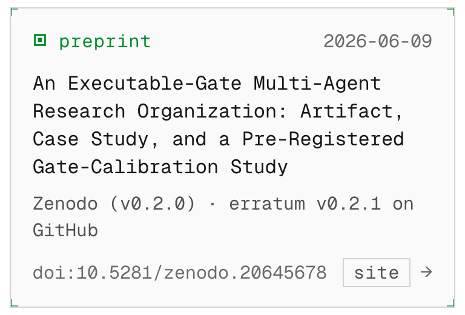</picture></a><a href="https://kacpersaks.dev/research/validation-crisis"><picture><source media="(min-width: 1200px) and (prefers-color-scheme: dark)" srcset="./assets/paper-validation-crisis-connected-dark.png" width="372" /><source media="(min-width: 1200px) and (prefers-color-scheme: light)" srcset="./assets/paper-validation-crisis-connected-light.png" width="372" /><source media="(prefers-color-scheme: dark)" srcset="./assets/paper-validation-crisis-dark.png" />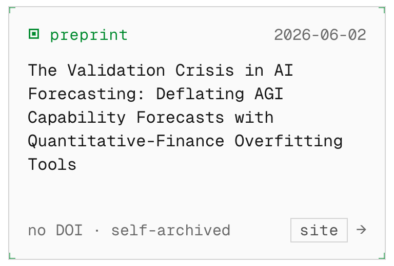</picture></a>

<a href="https://kacpersaks.dev/projects"><picture><source media="(min-width: 1200px) and (prefers-color-scheme: dark)" srcset="./assets/section-projects-connected-dark.png" width="744" /><source media="(min-width: 1200px) and (prefers-color-scheme: light)" srcset="./assets/section-projects-connected-light.png" width="744" /><source media="(prefers-color-scheme: dark)" srcset="./assets/section-projects-dark.png" /></picture></a> <a href="https://github.com/Ricko12vPL/worldclass-research-org"><picture><source media="(min-width: 1200px) and (prefers-color-scheme: dark)" srcset="./assets/project-worldclass-research-org-connected-dark.png" width="248" /><source media="(min-width: 1200px) and (prefers-color-scheme: light)" srcset="./assets/project-worldclass-research-org-connected-light.png" width="248" /><source media="(prefers-color-scheme: dark)" srcset="./assets/project-worldclass-research-org-dark.png" />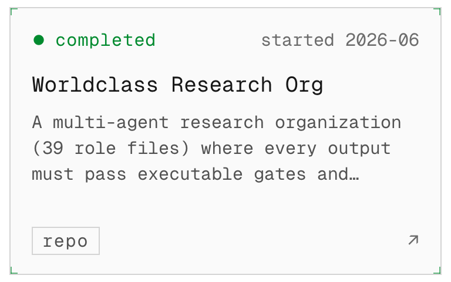</picture></a><a href="https://kacpersaks.dev/projects/x-quant"><picture><source media="(min-width: 1200px) and (prefers-color-scheme: dark)" srcset="./assets/project-x-quant-connected-dark.png" width="248" /><source media="(min-width: 1200px) and (prefers-color-scheme: light)" srcset="./assets/project-x-quant-connected-light.png" width="248" /><source media="(prefers-color-scheme: dark)" srcset="./assets/project-x-quant-dark.png" />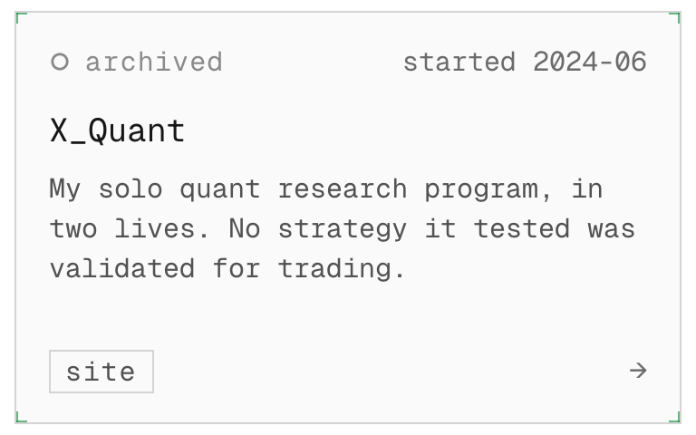</picture></a><a href="https://kacpersaks.dev/projects/alpha-lab"><picture><source media="(min-width: 1200px) and (prefers-color-scheme: dark)" srcset="./assets/project-alpha-lab-connected-dark.png" width="248" /><source media="(min-width: 1200px) and (prefers-color-scheme: light)" srcset="./assets/project-alpha-lab-connected-light.png" width="248" /><source media="(prefers-color-scheme: dark)" srcset="./assets/project-alpha-lab-dark.png" />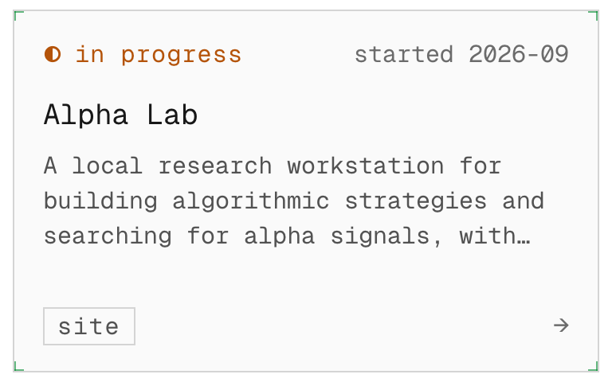</picture></a> <a href="https://kacpersaks.dev/projects/ukenergy"><picture><source media="(min-width: 1200px) and (prefers-color-scheme: dark)" srcset="./assets/project-ukenergy-connected-dark.png" width="248" /><source media="(min-width: 1200px) and (prefers-color-scheme: light)" srcset="./assets/project-ukenergy-connected-light.png" width="248" /><source media="(prefers-color-scheme: dark)" srcset="./assets/project-ukenergy-dark.png" />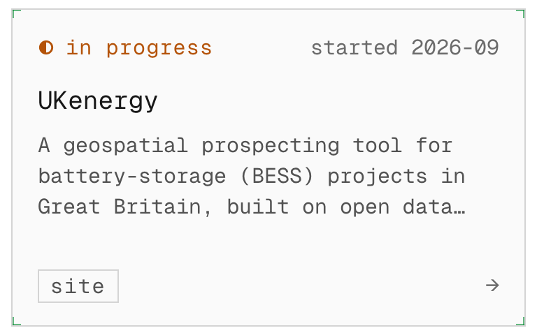</picture></a><a href="https://kacpersaks.dev/projects/job-agent"><picture><source media="(min-width: 1200px) and (prefers-color-scheme: dark)" srcset="./assets/project-job-agent-connected-dark.png" width="248" /><source media="(min-width: 1200px) and (prefers-color-scheme: light)" srcset="./assets/project-job-agent-connected-light.png" width="248" /><source media="(prefers-color-scheme: dark)" srcset="./assets/project-job-agent-dark.png" />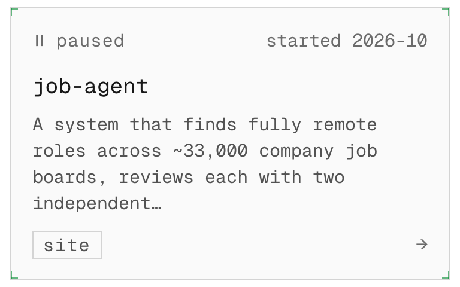</picture></a><a href="https://github.com/Ricko12vPL/QuantBrief"><picture><source media="(min-width: 1200px) and (prefers-color-scheme: dark)" srcset="./assets/project-quantbrief-connected-dark.png" width="248" /><source media="(min-width: 1200px) and (prefers-color-scheme: light)" srcset="./assets/project-quantbrief-connected-light.png" width="248" /><source media="(prefers-color-scheme: dark)" srcset="./assets/project-quantbrief-dark.png" />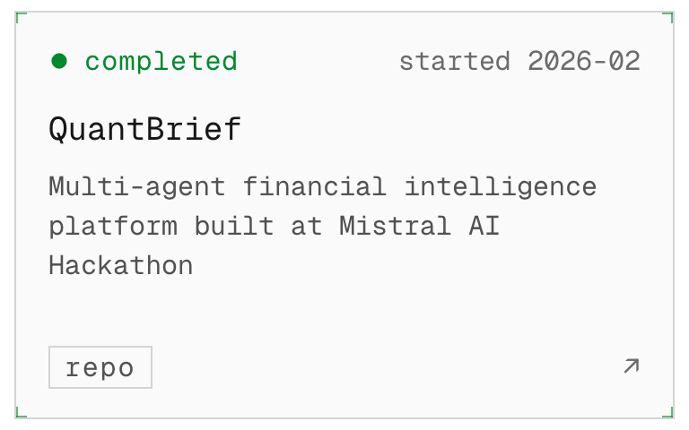</picture></a> <a href="https://kacpersaks.dev/projects/esg-compliance-agent"><picture><source media="(min-width: 1200px) and (prefers-color-scheme: dark)" srcset="./assets/project-esg-compliance-agent-connected-dark.png" width="372" /><source media="(min-width: 1200px) and (prefers-color-scheme: light)" srcset="./assets/project-esg-compliance-agent-connected-light.png" width="372" /><source media="(prefers-color-scheme: dark)" srcset="./assets/project-esg-compliance-agent-dark.png" />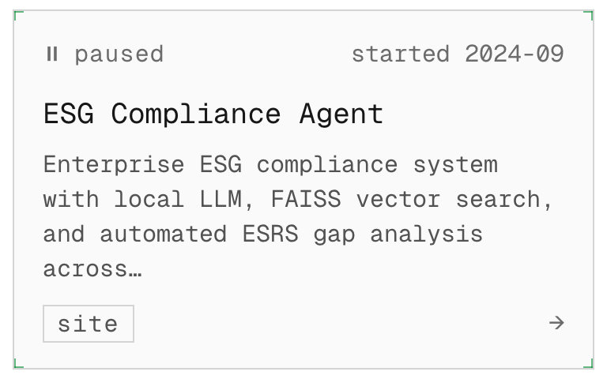</picture></a><a href="https://kacpersaks.dev/projects/airbus-document-analyzer"><picture><source media="(min-width: 1200px) and (prefers-color-scheme: dark)" srcset="./assets/project-airbus-document-analyzer-connected-dark.png" width="372" /><source media="(min-width: 1200px) and (prefers-color-scheme: light)" srcset="./assets/project-airbus-document-analyzer-connected-light.png" width="372" /><source media="(prefers-color-scheme: dark)" srcset="./assets/project-airbus-document-analyzer-dark.png" />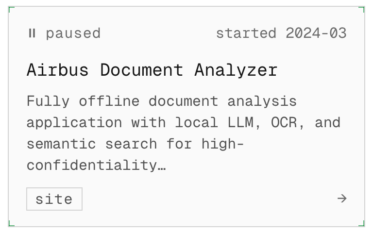</picture></a> <a href="https://kacpersaks.dev/projects"><picture><source media="(min-width: 1200px) and (prefers-color-scheme: dark)" srcset="./assets/project-index-connected-dark.png" width="744" /><source media="(min-width: 1200px) and (prefers-color-scheme: light)" srcset="./assets/project-index-connected-light.png" width="744" /><source media="(prefers-color-scheme: dark)" srcset="./assets/project-index-dark.png" />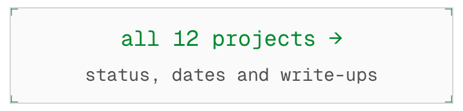</picture></a>

<a href="https://kacpersaks.dev/projects"><picture><source media="(min-width: 1200px) and (prefers-color-scheme: dark)" srcset="./assets/section-open-source-connected-dark.png" width="744" /><source media="(min-width: 1200px) and (prefers-color-scheme: light)" srcset="./assets/section-open-source-connected-light.png" width="744" /><source media="(prefers-color-scheme: dark)" srcset="./assets/section-open-source-dark.png" /></picture></a> <a href="https://github.com/Ricko12vPL/neo-triage-hack"><picture><source media="(min-width: 1200px) and (prefers-color-scheme: dark)" srcset="./assets/oss-neo-triage-hack-connected-dark.png" width="248" /><source media="(min-width: 1200px) and (prefers-color-scheme: light)" srcset="./assets/oss-neo-triage-hack-connected-light.png" width="248" /><source media="(prefers-color-scheme: dark)" srcset="./assets/oss-neo-triage-hack-dark.png" />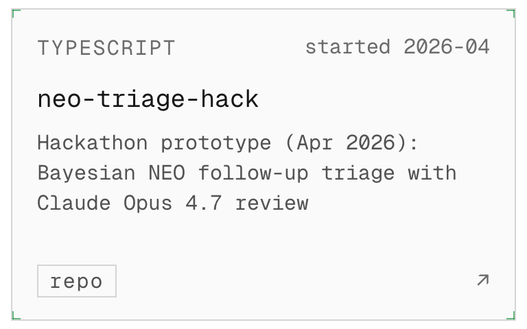</picture></a><a href="https://github.com/Ricko12vPL/claude-code-skills"><picture><source media="(min-width: 1200px) and (prefers-color-scheme: dark)" srcset="./assets/oss-claude-code-skills-connected-dark.png" width="248" /><source media="(min-width: 1200px) and (prefers-color-scheme: light)" srcset="./assets/oss-claude-code-skills-connected-light.png" width="248" /><source media="(prefers-color-scheme: dark)" srcset="./assets/oss-claude-code-skills-dark.png" />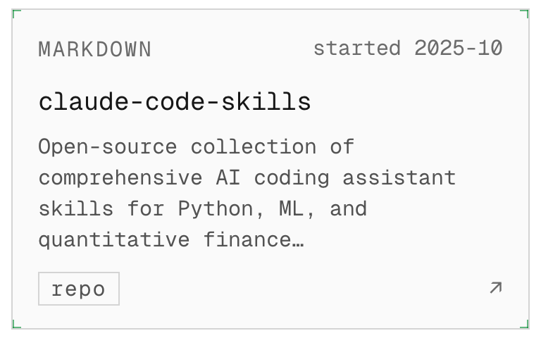</picture></a><a href="https://github.com/Ricko12vPL/Amazing_Maze"><picture><source media="(min-width: 1200px) and (prefers-color-scheme: dark)" srcset="./assets/oss-amazing-maze-connected-dark.png" width="248" /><source media="(min-width: 1200px) and (prefers-color-scheme: light)" srcset="./assets/oss-amazing-maze-connected-light.png" width="248" /><source media="(prefers-color-scheme: dark)" srcset="./assets/oss-amazing-maze-dark.png" />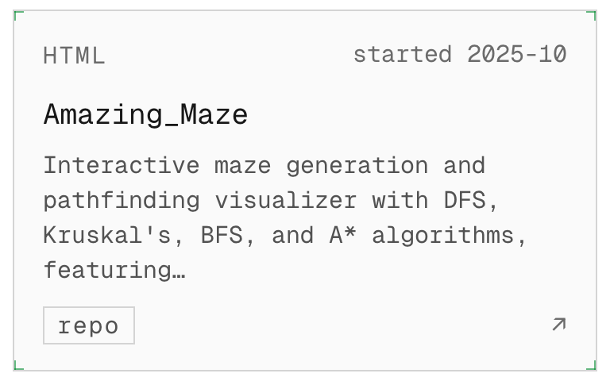</picture></a>

<a href="https://kacpersaks.dev/blog"><picture><source media="(min-width: 1200px) and (prefers-color-scheme: dark)" srcset="./assets/section-log-connected-dark.png" width="744" /><source media="(min-width: 1200px) and (prefers-color-scheme: light)" srcset="./assets/section-log-connected-light.png" width="744" /><source media="(prefers-color-scheme: dark)" srcset="./assets/section-log-dark.png" /></picture></a> <a href="https://kacpersaks.dev/blog"><picture><source media="(min-width: 1200px) and (prefers-color-scheme: dark)" srcset="./assets/log-connected-dark.png" width="744" /><source media="(min-width: 1200px) and (prefers-color-scheme: light)" srcset="./assets/log-connected-light.png" width="744" /><source media="(prefers-color-scheme: dark)" srcset="./assets/log-dark.png" />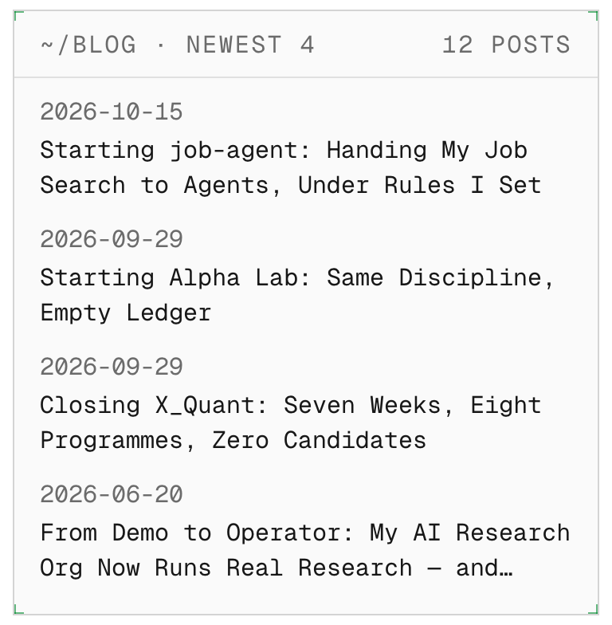</picture></a> <a href="https://kacpersaks.dev"><picture><source media="(min-width: 1200px) and (prefers-color-scheme: dark)" srcset="./assets/link-site-connected-dark.png" width="248" /><source media="(min-width: 1200px) and (prefers-color-scheme: light)" srcset="./assets/link-site-connected-light.png" width="248" /><source media="(prefers-color-scheme: dark)" srcset="./assets/link-site-dark.png" />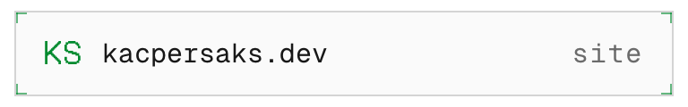</picture></a><a href="https://linkedin.com/in/kacpersakspe"><picture><source media="(min-width: 1200px) and (prefers-color-scheme: dark)" srcset="./assets/link-linkedin-connected-dark.png" width="248" /><source media="(min-width: 1200px) and (prefers-color-scheme: light)" srcset="./assets/link-linkedin-connected-light.png" width="248" /><source media="(prefers-color-scheme: dark)" srcset="./assets/link-linkedin-dark.png" /></picture></a><a href="mailto:kacpersaks@proton.me"><picture><source media="(min-width: 1200px) and (prefers-color-scheme: dark)" srcset="./assets/link-email-connected-dark.png" width="248" /><source media="(min-width: 1200px) and (prefers-color-scheme: light)" srcset="./assets/link-email-connected-light.png" width="248" /><source media="(prefers-color-scheme: dark)" srcset="./assets/link-email-dark.png" /></picture></a>

The cards above as plain links:

- **Research:** [An Executable-Gate Multi-Agent Research Organization](https://kacpersaks.dev/research/executable-gate-research-org "An Executable-Gate Multi-Agent Research Organization: Artifact, Case Study, and a Pre-Registered Gate-Calibration Study") (preprint, 2026-06-09, [DOI](https://doi.org/10.5281/zenodo.20645678)) · [The Validation Crisis in AI Forecasting](https://kacpersaks.dev/research/validation-crisis "The Validation Crisis in AI Forecasting: Deflating AGI Capability Forecasts with Quantitative-Finance Overfitting Tools") (preprint, 2026-06-02)
- **Projects:** [Worldclass Research Org](https://github.com/Ricko12vPL/worldclass-research-org "A multi-agent research organization (39 role files) where every output must pass executable gates and…") · [X\_Quant](https://kacpersaks.dev/projects/x-quant "My solo quant research program, in two lives. No strategy it tested was validated for trading.") · [Alpha Lab](https://kacpersaks.dev/projects/alpha-lab "A local research workstation for building algorithmic strategies and searching for alpha signals, with…") · [UKenergy](https://kacpersaks.dev/projects/ukenergy "A geospatial prospecting tool for battery-storage (BESS) projects in Great Britain, built on open data…") · [job-agent](https://kacpersaks.dev/projects/job-agent "A system that finds fully remote roles across ~33,000 company job boards, reviews each with two independent…") · [QuantBrief](https://github.com/Ricko12vPL/QuantBrief "Multi-agent financial intelligence platform built at Mistral AI Hackathon") · [ESG Compliance Agent](https://kacpersaks.dev/projects/esg-compliance-agent "Enterprise ESG compliance system with local LLM, FAISS vector search, and automated ESRS gap analysis across…") · [Airbus Document Analyzer](https://kacpersaks.dev/projects/airbus-document-analyzer "Fully offline document analysis application with local LLM, OCR, and semantic search for high-confidentiality…") · [all 12 projects](https://kacpersaks.dev/projects)
- **Open source:** [neo-triage-hack](https://github.com/Ricko12vPL/neo-triage-hack "Hackathon prototype (Apr 2026): Bayesian NEO follow-up triage with Claude Opus 4.7 review") · [claude-code-skills](https://github.com/Ricko12vPL/claude-code-skills "Open-source collection of comprehensive AI coding assistant skills for Python, ML, and quantitative finance…") · [Amazing\_Maze](https://github.com/Ricko12vPL/Amazing_Maze "Interactive maze generation and pathfinding visualizer with DFS, Kruskal's, BFS, and A* algorithms, featuring…")
- **Log:** [Starting job-agent](https://kacpersaks.dev/blog/starting-job-agent "Starting job-agent: Handing My Job Search to Agents, Under Rules I Set") (2026-10-15) · [Starting Alpha Lab](https://kacpersaks.dev/blog/starting-alpha-lab "Starting Alpha Lab: Same Discipline, Empty Ledger") (2026-09-29) · [Closing X\_Quant](https://kacpersaks.dev/blog/closing-x-quant "Closing X_Quant: Seven Weeks, Eight Programmes, Zero Candidates") (2026-09-29) · [From Demo to Operator](https://kacpersaks.dev/blog/research-org-runs-real-research "From Demo to Operator: My AI Research Org Now Runs Real Research — and Reviews Its Own Papers Before I Do") (2026-06-20)
- **Contact:** [kacpersaks.dev](https://kacpersaks.dev) · [LinkedIn](https://linkedin.com/in/kacpersakspe) · [kacpersaks@proton.me](mailto:kacpersaks@proton.me)
